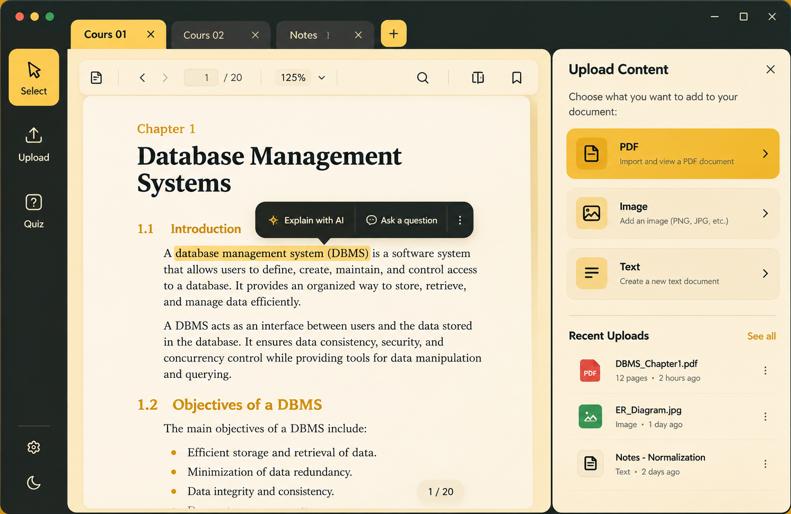

<div align="center">

<br/>

<!-- Logo / Title -->


<h3>✦ &nbsp; Your intelligent workspace for focused learning &nbsp; ✦</h3>

<br/>

<!-- Badges -->
[](https://python.org)
[](https://doc.qt.io/qtforpython/)
[](https://ollama.com)
[](https://sqlite.org)
[](LICENSE)
[](https://microsoft.com/windows)

<br/>

> **Read. Understand. Practice. Repeat.**
>
> NotepadLLM is a modern, AI-powered desktop study application built with Python and PySide6.
> It combines document reading, intelligent explanations, note-taking, and interactive quizzes
> into a single distraction-free workspace — powered entirely by **local AI**. No cloud. No API keys. No tracking.

<br/>

</div>

---

<div align="center">

## 📸 &nbsp; Application Preview

<br/>



<sub><sup>✦ &nbsp; Multi-tab PDF reader · AI explanations · Upload panel · Recent documents &nbsp; ✦</sup></sub>

<br/>

</div>

---

## ✨ &nbsp; Features

<br/>

<table>
<tr>
<td width="50%" valign="top">

### 📄 &nbsp; Intelligent Document Workspace

A clean, focused reading environment for all your study materials.

- **Multi-tab interface** — juggle multiple documents at once
- **PDF Reader** — page navigation, zoom controls, text selection
- **Image Viewer** — import diagrams, slides, and visual notes
- **Text Editor** — write and save personal study notes
- **Session Persistence** — pick up exactly where you left off

</td>
<td width="50%" valign="top">

### 🤖 &nbsp; Context-Aware AI Assistant

Select any passage and let the AI explain it using your document's full context.

- Instant explanations through a smart contextual popup
- Simplified **or** detailed explanations on demand
- Follow-up questions for deeper understanding
- Fully document-aware responses
- Choose your own locally installed model
- 100% offline — your content never leaves your machine

</td>
</tr>
<tr>
<td width="50%" valign="top">

### 🧠 &nbsp; Smart Quiz Generator

Turn your study materials into interactive quizzes in seconds.

- Generate quizzes directly from any document
- Target specific chapters or page ranges
- Configure difficulty level and question count
- Multiple-choice with automatic scoring
- Detailed answer explanations after each attempt
- Track your progress over time

</td>
<td width="50%" valign="top">

### 🔒 &nbsp; Privacy by Design

Your documents stay on your computer. Always.

- **No account required** — open and run immediately
- **No API keys** — no subscriptions, no costs
- **No cloud processing** — AI runs entirely on-device via Ollama
- **No telemetry** — nothing is ever sent anywhere
- Works fully offline after initial setup

</td>
</tr>
</table>

---

## 🚀 &nbsp; Quick Start

### Prerequisites

Make sure you have the following installed before running NotepadLLM:

| Requirement | Version | Link |
|---|---|---|
| Python | 3.12 or later | [python.org](https://python.org) |
| Ollama | Latest | [ollama.com](https://ollama.com) |
| A local LLM | Any Ollama model | `ollama pull gemma2:2b` |

<br/>

### Installation

**1. Clone the repository**

```bash
git clone https://github.com/AaronDAmin/notepadLLM.git
cd notepadLLM
```

**2. Create a virtual environment**

```bash
python -m venv .venv
.venv\Scripts\activate      # Windows
# source .venv/bin/activate # macOS / Linux
```

**3. Install dependencies**

```bash
pip install -r requirements.txt
```

**4. Start Ollama**

```bash
ollama serve          # start the local AI server
ollama list           # verify your installed models
```

> No model yet? Pull one: `ollama pull gemma2:2b`

**5. Launch NotepadLLM** 🎉

```bash
python main.py
```

Open **Settings** to select your preferred model, then start studying.

---

## 🔄 &nbsp; How It Works

```
┌──────────────────────────────────────────────────────────────────────┐
│                                                                      │
│  1. IMPORT  ──▶  2. READ & SELECT  ──▶  3. AI EXPLAIN  ──▶  4. QUIZ │
│                                                                      │
│  Upload PDF,      Highlight any        Get instant        Generate   │
│  image or text    concept or           contextual AI      and take   │
│  document         passage              explanation        a quiz     │
│                                                                      │
└──────────────────────────────────────────────────────────────────────┘
```

**Step 1 — Import** &nbsp; Open a PDF, image, or text file from the Upload panel.

**Step 2 — Read & Select** &nbsp; Navigate through your document. Highlight any passage that needs clarification.

**Step 3 — Explain with AI** &nbsp; Click *Explain with AI* in the popup. The local model reads your selection in context and returns a clear explanation.

**Step 4 — Test Yourself** &nbsp; Open Quiz mode, configure your parameters, and answer AI-generated multiple-choice questions.

---

## 🏗 &nbsp; Project Architecture

```
notepadLLM/
│
├── main.py                     ← Entry point
├── requirements.txt
│
├── app/
│   ├── core/
│   │   ├── config.py           ← App constants & paths
│   │   ├── database.py         ← SQLite setup & migrations
│   │   └── models.py           ← Data models
│   │
│   ├── ui/
│   │   ├── main_window.py      ← Root window & layout
│   │   ├── sidebar.py          ← Left navigation bar
│   │   ├── tab_bar.py          ← Multi-tab document bar
│   │   ├── workspace.py        ← Central document area
│   │   ├── pdf_viewer.py       ← PDF rendering & navigation
│   │   ├── image_viewer.py     ← Image display
│   │   ├── text_editor.py      ← Notes editor
│   │   ├── ai_popup.py         ← AI explanation popup
│   │   ├── quiz_view.py        ← Quiz configuration & play
│   │   └── dialogs/            ← Error & upload dialogs
│   │
│   ├── services/
│   │   ├── context_service.py  ← Document context extraction
│   │   ├── ollama_service.py   ← Ollama API client
│   │   ├── pdf_service.py      ← PDF parsing (PyMuPDF)
│   │   └── quiz_service.py     ← Quiz generation logic
│   │
│   ├── workers/
│   │   ├── ai_worker.py        ← Background AI thread
│   │   └── quiz_worker.py      ← Background quiz thread
│   │
│   └── storage/
│       └── repositories.py     ← SQLite CRUD layer
│
└── assets/
    ├── icons/
    ├── styles/                 ← QSS theme + color palette
    └── screenshots/
```

---

## 🎨 &nbsp; Design System — MUSTARD

NotepadLLM uses a custom **MUSTARD** design language: bold, warm, and distraction-free.

<br/>

<div align="center">

| &nbsp; | Swatch | Name | Hex | Usage |
|:---:|:---:|---|---|---|
| 🟫 |  | Charcoal | `#282B28` | Sidebar, window chrome |
| 🟨 |  | Mustard | `#F0C94C` | Active tabs, buttons, highlights |
| 🟧 |  | Dark Mustard | `#D4A017` | Headings, accents, links |
| 🟡 |  | Mustard Light | `#FAD870` | Hover tints |
| 🟤 |  | Soft Cream | `#F7E7B5` | Panels, secondary surfaces |
| ⬜ |  | Off-White | `#FFF8EC` | Document area background |

</div>

<br/>

The interface pairs warm tones with a charcoal shell, rounded corners, clean Segoe UI typography, and restrained iconography — designed to keep your focus on the content, not the chrome.

---

## 🧰 &nbsp; Tech Stack

<br/>

<div align="center">

| Layer | Technology |
|---|---|
| Language | Python 3.12+ |
| UI Framework | PySide6 / Qt 6 |
| Styling | Qt Style Sheets (QSS) |
| PDF Engine | PyMuPDF (fitz) |
| AI Runtime | Ollama |
| AI Models | Any locally installed Ollama model |
| Storage | SQLite (via built-in `sqlite3`) |
| Threading | QThread + Qt Workers |
| Platform | Windows 10 / 11 |

</div>

---

## ⚡ &nbsp; Performance & Offline Support

NotepadLLM is built to run comfortably on everyday desktop hardware.

- **No internet required** after setup — works fully offline
- Lightweight Qt native interface with minimal overhead
- Background threads for AI inference — UI stays smooth
- Local SQLite storage — instant reads, zero latency
- Quantized models supported (e.g. `gemma2:2b` runs on 8 GB RAM)
- Efficient PDF page rendering with on-demand caching

> Inference speed depends on your hardware and the selected model. Quantized 2B–4B models work well on most modern laptops.

---

## 🤝 &nbsp; Contributing

Contributions, suggestions, and bug reports are very welcome.

1. Fork the repository
2. Create a feature branch: `git checkout -b feat/your-feature`
3. Implement and test your changes
4. Commit: `git commit -m "feat: describe your change"`
5. Push and open a Pull Request

Please keep contributions consistent with the project's **lightweight, privacy-first** philosophy.

---

## 📄 &nbsp; License

This project is licensed under the **MIT License** — see the [`LICENSE`](LICENSE) file for details.

---

<div align="center">

<br/>

**NotepadLLM**

*Smarter studying. Powered by local AI.*

<sub>Built with 🐍 Python · ⚡ PySide6 · 🦙 Ollama</sub>

<br/>

</div>
